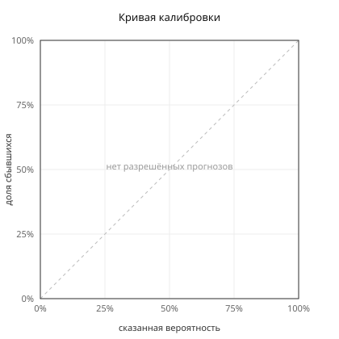

# Прогнозы по AI-индустрии: открытый трек-рекорд

Я публикую прогнозы по AI-индустрии с вероятностями и дедлайнами, а потом
подвожу итог по каждому. Сбывшиеся и несбывшиеся лежат рядом, счёт ведётся
открыто, промахи видны все.

Обычный прогнозист показывает удачные попадания. Этот репозиторий устроен
так, чтобы это было невозможно: каждый прогноз это отдельный коммит, история
коммитов неизменяема, ни один файл после публикации не правится и не удаляется.
Проверить меня можно без доверия ко мне, через `git log`.

**Зачем.** Я занимаюсь внедрением AI в бизнес, и мои решения опираются на
представление о том, куда движется индустрия. Публичный счёт это способ
проверить, стоит ли это представление чего-нибудь, и заодно способ научиться
прогнозировать лучше. Если калибровка окажется плохой, это тоже будет видно.

---

## Счёт

<!-- SCORE:START -->

**Счёт**

```
Всего прогнозов      0
Открыто              0
Разрешено            0
  сбылось            0
  не сбылось         0
  аннулировано       0
Просрочено           0

Brier score          пока нет разрешённых прогнозов
```

**Калибровка по декам**

```
вероятность   прогнозов   сбылось   идеально
0-10%                 0         -          -
10-20%                0         -          -
20-30%                0         -          -
30-40%                0         -          -
40-50%                0         -          -
50-60%                0         -          -
60-70%                0         -          -
70-80%                0         -          -
80-90%                0         -          -
90-100%               0         -          -
```



**Разрешённые прогнозы**

Пока ни одного. Первые дедлайны впереди.

**Открытые прогнозы**

Пока ни одного.

_Таблица собрана автоматически: `scripts/score.py`. Руками не редактируется._

<!-- SCORE:END -->

---

## Как читать вероятности

«65%» не значит «я думаю, что это произойдёт». Это значит: если взять все мои
прогнозы, где я сказал около 65%, примерно 65% из них должны сбыться. Меньше
значит я самоуверен, больше значит я перестраховываюсь. Именно это и показывает
кривая калибровки.

Один прогноз ничего не доказывает. Прогнозиста имеет смысл оценивать только
по распределению, и только на дистанции. Поэтому здесь есть счёт, а не подборка
удачных случаев.

**Brier score** это средний квадрат ошибки: `mean((p - исход)^2)`, где исход
равен 1 или 0. Ноль это идеал, 0.25 это результат человека, который на всё
отвечает «50%». Любой результат хуже 0.25 означает, что монетка справляется
лучше меня.

## Правила, которые я на себя накладываю

1. **Прогноз должен резолвиться.** Проверяемое событие, дата, вероятность от 1
   до 99. Критерий «что считается да» пишется заранее, в том же коммите.
   Никаких «AI изменит рынок труда».
2. **Ничего не удаляется и не правится задним числом.** После публикации
   формулировка, вероятность и рассуждение заморожены. Резолюция дописывается
   в конец файла отдельным коммитом.
3. **Резолюция по внешнему источнику.** Каждая резолюция обязана ссылаться на
   публичный источник, а источник архивируется в Wayback Machine. Скрипт не даст
   закрыть прогноз без ссылки.
4. **Аннулирование это тоже промах.** Если критерий оказался неоднозначным,
   прогноз помечается как аннулированный, остаётся в репозитории и получает
   разбор «почему я плохо сформулировал». Из Brier score он исключается, из
   истории нет.
5. **Дубли на внешних площадках.** Где возможно, тот же прогноз ставится на
   Metaculus или Manifold, чтобы счёт вёл кто-то, кроме меня. Ссылка в поле
   `mirror`.

Подробнее: [METHODOLOGY.md](METHODOLOGY.md).

## Как устроен репозиторий

```
forecasts/          один файл = один прогноз = один коммит
  TEMPLATE.md       шаблон
scripts/score.py    Brier score, калибровка, генерация таблиц выше
scripts/archive.py  отправка ссылок в Wayback Machine
tests/              проверка арифметики скоринга на синтетических данных
docs/calibration.svg  кривая калибровки, перерисовывается автоматически
```

Таблицы в этом README собираются GitHub Action при каждом изменении в
`forecasts/` и раз в сутки по расписанию. Руками они не редактируются.

Пересчитать локально:

```bash
python scripts/score.py          # обновить README и график
python scripts/score.py --check  # проверить, что README не устарел
python tests/test_score.py       # проверить арифметику
```

Зависимостей нет, нужен только Python 3.11+.

## Нашли ошибку в резолюции

Откройте issue. Если я закрыл прогноз неправильно, я не правлю старый коммит,
а добавляю новый с исправлением и объяснением. Спор о резолюции остаётся
в истории вместе с прогнозом.

## Лицензия

Тексты прогнозов: [CC BY 4.0](LICENSE). Код в `scripts/` и `tests/`: MIT.
